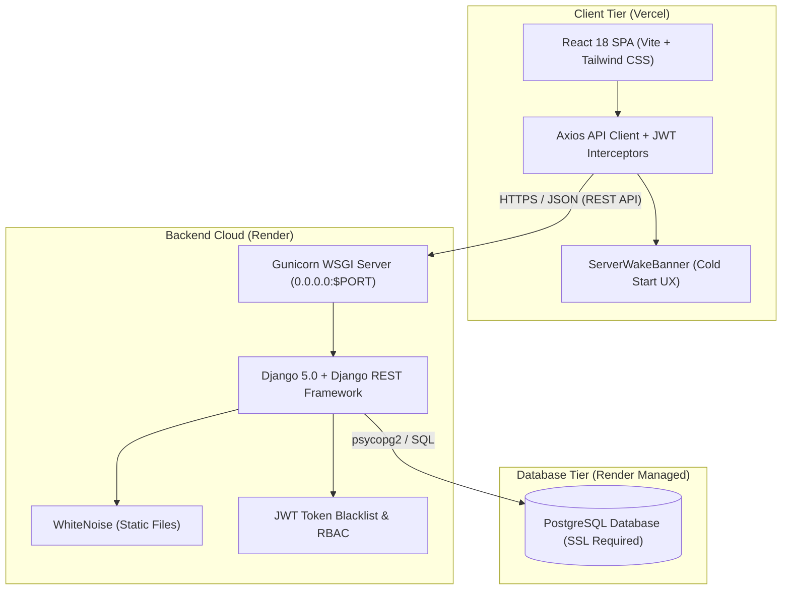

# Academic Course Registration and Enrollment System (SEAP-CES)

A full-stack, enterprise-grade academic course registration and management portal built with **Django REST Framework** and **React (Vite)**. SEAP-CES streamlines course offerings, student enrollment workflows, faculty approvals, and HOD administration.

---

## Architecture Overview



---

## Key Features & Roles

- **Student Portal**: Self-registration, browse active course offerings, submit enrollment requests, track approval status, withdraw from enrolled courses, view semester GPA and cumulative academic records.
- **Faculty Portal**: Account registration with HOD approval gating, manage assigned course offerings, approve/reject student enrollment requests with reason, grade student completions.
- **HOD Administration**: Complete departmental oversight, approve/reject/suspend faculty accounts, manage courses and semester offerings, manual enrollment overrides with mandatory audit justification, academic record adjustments, statistical reports (with CSV exports), and an immutable system audit log.
- **Resilience & Production Hardening**: Render free-tier cold start handling with automatic ping/retry UX banner, SSL proxy headers, hardened cookies, rate limiting, and zero hardcoded production URLs.

---

## Local Development Setup

### 1. Prerequisites
- Python 3.11+
- Node.js 18+ and npm
- Git

### 2. Backend Setup
```bash
cd backend
python -m venv .venv

# Windows (PowerShell):
.venv\Scripts\Activate.ps1
# macOS / Linux:
source .venv/bin/activate

# Install dependencies
pip install -r requirements.txt

# Configure environment
cp .env.example .env

# Run database migrations
python manage.py migrate

# Seed deterministic demo data (idempotent)
python manage.py seed_demo

# Start the development server
python manage.py runserver
```
The API backend will run at `http://localhost:8000/api`. Verify with `http://localhost:8000/api/health/`.

### 3. Frontend Setup
```bash
cd frontend
npm install

# Start Vite development server
npm run dev
```
The frontend UI will run at `http://localhost:5173`.

---

## Environment Variables

### Backend (`backend/.env`)

| Variable | Description | Default (Dev) | Production (Render) |
|---|---|---|---|
| `SECRET_KEY` | Cryptographic signing key | `dev-secret-key-...` | Render auto-generated |
| `DEBUG` | Django debug mode | `True` | `False` |
| `ALLOWED_HOSTS` | Comma-separated allowed hostnames | `localhost,127.0.0.1,testserver` | `.onrender.com` |
| `DATABASE_URL` | Database connection URL | `sqlite:///db.sqlite3` | Render PostgreSQL internal URL |
| `CORS_ALLOWED_ORIGINS` | Allowed frontend origins | `http://localhost:5173` | `https://<your-project>.vercel.app` |
| `CSRF_TRUSTED_ORIGINS` | Trusted origins for CSRF | `http://localhost:5173` | `https://<your-project>.vercel.app` |
| `SESSION_COOKIE_SECURE` | Secure flag on session cookies | `False` | `True` |
| `CSRF_COOKIE_SECURE` | Secure flag on CSRF cookies | `False` | `True` |
| `SECURE_HSTS_SECONDS` | HTTP Strict Transport Security | `0` | `31536000` |

### Frontend (`frontend/.env`)

| Variable | Description | Default (Dev) | Production (Vercel) |
|---|---|---|---|
| `VITE_API_URL` | Base URL for REST API | `http://localhost:8000/api` | `https://<render-service>.onrender.com/api` |

---

## Seeded Demo Accounts

All seeded demo accounts share the password: **`Demo@1234`**

| Role | Email | Status / Notes |
|---|---|---|
| **HOD** | `hod@demo.com` | Computer Science & Engineering HOD |
| **Faculty** | `alice@demo.com` | Active faculty (CSE) |
| **Faculty** | `bob@demo.com` | Active faculty (CSE) |
| **Faculty** | `carol@demo.com` | Active faculty (ECE) |
| **Faculty** | `dave@demo.com` | **Pending** (requires HOD approval) |
| **Student** | `s001@demo.com` | CGPA 9.20 |
| **Student** | `s002@demo.com` | CGPA 8.45 |
| **Student** | `s003@demo.com` – `s010@demo.com` | Various CGPAs (6.20 to 9.50) |

To seed demo data in production or with `DEBUG=False`, pass `--force`:
```bash
python manage.py seed_demo --force
```

---

## Testing Commands

### Backend Automated Tests (60/60 passing)
Includes full security checks, swapped-ID access verification, and RBAC matrix:
```bash
cd backend
python manage.py test
```

### Frontend Production Build
```bash
cd frontend
npm run build
```

### End-to-End Playwright Smoke Tests
```bash
# Run against local running stack
npm run test:e2e
```

---

## Production Deployment Guide

### A. Backend on Render
1. Push your repository to GitHub.
2. In [Render Dashboard](https://dashboard.render.com):
   - Create a **PostgreSQL Database** (Free tier named `seap-ces-db`). Copy the internal connection URL.
   - Create a **Web Service** connected to your repo:
     - **Root Directory**: `backend`
     - **Build Command**: `./build.sh`
     - **Start Command**: `./start.sh`
     - **Environment Variables**:
       - `DEBUG`: `False`
       - `SECRET_KEY`: *(Generate a secure random 50+ character string)*
       - `DATABASE_URL`: *(Paste PostgreSQL internal connection URL)*
       - `ALLOWED_HOSTS`: `.onrender.com`
       - `CORS_ALLOWED_ORIGINS`: `https://seap-ces-frontend.onrender.com`
       - `CSRF_TRUSTED_ORIGINS`: `https://seap-ces-frontend.onrender.com`
       - `SESSION_COOKIE_SECURE`: `True`
       - `CSRF_COOKIE_SECURE`: `True`
       - `SECURE_HSTS_SECONDS`: `31536000`
       - `HOD_EMAIL`: `hod@demo.com` *(auto-creates HOD on deploy, no shell needed)*
       - `HOD_PASSWORD`: `Demo@1234`
       - `SEED_DEMO`: `true` *(auto-seeds demo accounts and courses on startup)*
3. Once deployed, open the Render **Shell** tab to initialize the HOD account:
   ```bash
   python manage.py create_hod hod@yourdomain.com StrongPass@1234 "Dr. Department Head" CSE
   ```
   *(Optional)* Populate demo dataset:
   ```bash
   python manage.py seed_demo --force
   ```
4. Verify deployment health at: `https://<your-service>.onrender.com/api/health/`

### B. Frontend on Vercel
1. In [Vercel Dashboard](https://vercel.com):
   - Import your GitHub repository.
   - **Root Directory**: Select `frontend`
   - **Framework Preset**: `Vite`
   - **Build Command**: `npm run build`
   - **Output Directory**: `dist`
   - **Environment Variables**:
     - `VITE_API_URL`: `https://<your-service>.onrender.com/api`
2. Deploy. SPA client-side routing is handled by `frontend/vercel.json`.
3. Add your production Vercel URL to `CORS_ALLOWED_ORIGINS` and `CSRF_TRUSTED_ORIGINS` on Render and trigger a redeploy if needed.

---

## Live Deployment URLs

- **Frontend Web App**: `https://<your-project>.vercel.app` *(update after deployment)*
- **Backend API**: `https://<your-service>.onrender.com/api/`
- **API Health Check**: `https://<your-service>.onrender.com/api/health/`

---

## Specifications & Documentation

- [docs/QA.md](file:///d:/seap_ces/docs/QA.md) — Comprehensive QA checklist, SRS use-case coverage, and N+1 query audit.
- [docs/SRS_DELTA.md](file:///d:/seap_ces/docs/SRS_DELTA.md) — Documentation of changes and extensions from the original SRS.
